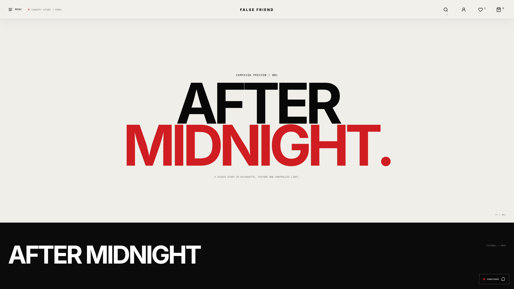
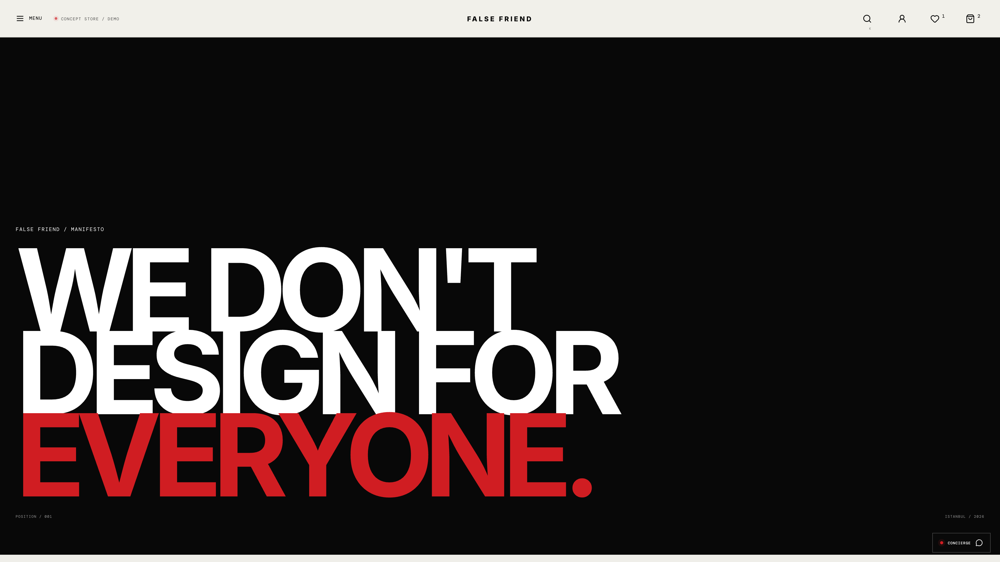
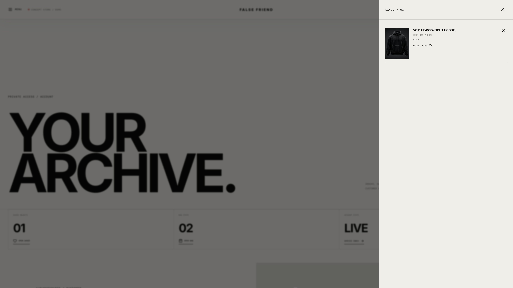
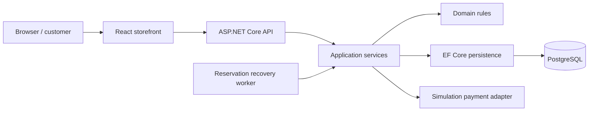

# False Friend — Cinematic E-Commerce Showcase

**A complete streetwear storefront concept, from scroll-driven storytelling to server-verified checkout.**

Designed and developed by **Kaan Tekin**. This repository presents the main False Friend project through real desktop/mobile screenshots, accelerated walkthroughs and implementation documentation.

[**Türkçe anlatım**](README.tr.md) · [**Desktop walkthrough · 2×**](assets/videos/desktop-walkthrough-2x.mp4) · [**Mobile walkthrough · 2×**](assets/videos/mobile-walkthrough-2x.mp4) · [**Discuss a project**](mailto:kaantekin06@icloud.com)

> **Showcase repository:** application source code, database dumps, credentials and deployment packages are kept outside this repository. Payments and refunds in the demonstrated application use a simulation adapter. This is a portfolio concept rather than a live merchandise shop.

## Contents

[Project](#the-project) · [Design](#visual-experience) · [Catalog](#products-and-catalog) · [Cart](#cart-wishlist-and-pricing) · [Checkout](#checkout-and-recovery) · [Accounts](#customer-accounts-and-store-operations) · [Mobile](#responsive-interaction-and-accessibility) · [Videos](#walkthrough-videos) · [Architecture](#how-it-was-built) · [Routes](#application-map) · [Verification](#verification-snapshot) · [Contact](#work-with-me)

## The project

False Friend explores how an editorial fashion experience can connect to practical commerce. The visual direction uses restrained typography, a dark product stage, oversized headlines, material studies and a consistent collection language. The backend provides the product, account, cart, order and operations behavior behind that interface.

The intended use is to demonstrate my work to prospective clients. The experience can be adapted to a client's brand and catalog, or used as a starting point for a separately scoped custom website. The main version shown here preserves its cinematic opening and AI-created concept product imagery. Template Edition is a separate presentation and is not included in this repository.

## Visual experience

- Scroll-driven opening video with staged Identity, Material, Form and Object reveals.
- Chapter controls, scroll progress and a direct link to the featured product.
- Dynamic hero product name, price and availability sourced from the catalog.
- Editorial collection blocks, material/construction studies and campaign layouts.
- Full-screen navigation with category previews, search, saved items and currency controls.
- Lookbook, manifesto, service, privacy and terms surfaces with a shared visual system.
- Loading transitions, image fallbacks and support for reduced motion.
- Hero poster fallback if the video cannot load; video seeking pauses when off-screen.

The opening motion was created with Gemini. Product visuals are AI-created concept assets; the screenshots and walkthroughs show the actual running website.

## Products and catalog

The demo catalog contains **eight products across four categories**: tops, outerwear, bottoms and accessories.

| Capability | Behavior |
| --- | --- |
| Collection browser | Category filters, catalog search, price/name sorting and editorial/compact density controls |
| Product details | Product description, composition, fit notes, price and availability |
| Variant selection | Size/color combinations, variant-specific prices and stock limits |
| Product media | Gallery navigation, thumbnails, pointer inspection and keyboard-accessible full-screen viewing |
| Quick interactions | Quick view/add controls, saved products and locally remembered recent products |
| Product guidance | Size architecture, available sizes, category guidance and service access |
| Live catalog changes | Added products can load from the backend after a frontend build |
| Product documents | Initial titles, social images, canonical URLs and structured product metadata use live backend data |
| Missing items | Genuine missing-product status and recovery links; API outages are handled separately |

Physical garment measurements are not provided in the concept catalog. Product materials, availability and delivery copy are demo content to be replaced for a real merchant.

## Cart, wishlist and pricing

Guests can keep a local bag and wishlist. Signing in synchronizes the selection with the account. The interface supports quantity changes, removal, saved items, coupon application and shipping-threshold feedback.

The server calculates authenticated cart prices and validates current product variants and stock. Restored guest selections are checked against the live catalog; stored client prices are not trusted as checkout prices. Late responses from an old login session cannot replace the active user's state. A failed partial account synchronization can be retried explicitly.

Currency display supports EUR, USD and GBP. USD/GBP use fixed illustrative conversion rates; **checkout settlement remains in EUR**.

## Checkout and recovery

The multi-step checkout covers a saved delivery destination, shipping selection, payment preview and final review.

1. The API builds an authoritative quote with item snapshots, shipping, discounts and totals.
2. A quote fingerprint binds the reviewed selection and price to the submitted order request.
3. Changed quotes require an explicit refresh and a new review before confirmation.
4. The order path validates stock and uses an idempotency key to protect a repeated attempt.
5. A small, user-scoped local record stores the attempt identifier before submission.
6. After a lost response or reload, a read-only lookup checks that attempt before another order is allowed.
7. Pending or unknown outcomes keep a new checkout blocked until the previous result is resolved.

Recovery is scoped to the same browser/origin and customer. It is not a cross-device recovery service or an atomic cross-tab payment lock.

**Payment and refund processing are simulations.** No real card is charged. The published walkthrough stops at order review; the broader local acceptance suite separately exercises simulated confirmation and refund flows.

## Editorial and service pages

The campaign experience includes a lookbook with object/material frames and an interactive reveal. The manifesto explains the concept's visual direction. Service pages cover illustrative delivery/returns guidance, sizing and garment care.

The concierge is an on-site service guide panel. The mailing-list interaction is an explicitly labeled preview and does not send email or create an external subscription.

## Customer accounts and store operations

| Area | Implemented application behavior |
| --- | --- |
| Customer access | Registration with password confirmation, login, logout and session validation |
| Profile | Customer details, loyalty-points display, saved address creation/editing/removal and default destination |
| Password change | Current-password validation, credential update and session invalidation |
| Orders | Account order history, details and protected tracking |
| Reviews | Verified-purchase eligibility and moderation workflow |
| Returns | Customer return requests, status checks and cancellation where allowed |
| Admin dashboard | Role-protected operational overview and order inspection |
| Order operations | Validated status transitions and shipping/tracking information |
| Moderation | Review approval and return processing |
| Inventory | Variant stock adjustment with an operator reason |
| Auditability | Operational audit events and trace context |
| Refund/recovery | Simulated refunds and expired checkout-reservation recovery |

The walkthrough shows customer-facing flows. Admin, order completion, moderation and refund behavior are described from the private application's implementation and local acceptance tests; they are not presented as footage in the walkthrough.

Email verification, transactional delivery and email-based forgotten-password recovery are not configured. The signed-in password-change flow is implemented.

## Responsive interaction and accessibility

The interface adapts across phone, tablet and desktop layouts. Mobile presentation includes a full navigation panel, product media, responsive product information, cart controls and checkout stages. Keyboard focus handling, modal focus traps, labels, escape controls and reduced-motion behavior are part of the implementation.

Local responsive testing covered widths from **320 to 1440 CSS pixels**. The showcase captures additionally include a 1920-pixel desktop viewport. Accessibility checks are a limited semantic smoke test, not a WCAG certification or a Safari/VoiceOver/device acceptance claim.

| Mobile storefront | Mobile product selection | Mobile checkout |
| --- | --- | --- |
|  |  |  |

## Walkthrough videos

Both files are encoded at **twice the captured speed**, rather than requiring a playback-speed setting. The desktop video is 1920×1080; the vertical mobile video is 430×932. Both use H.264 MP4 at 25 fps and have no added soundtrack.

| Desktop · about 47 seconds | Mobile · about 15 seconds |
| --- | --- |
|  |  |

[Open desktop MP4](assets/videos/desktop-walkthrough-2x.mp4) · [Open mobile MP4](assets/videos/mobile-walkthrough-2x.mp4)

Desktop chapters, approximately:

| Time at 2× | What is shown |
| --- | --- |
| 00:00 | Opening and scroll-driven scenes |
| 00:10 | Product, gallery and variant selection |
| 00:14 | Cart, quantity and coupon |
| 00:17 | Shipping and simulated checkout review |
| 00:24 | Collection, category filtering and search states |
| 00:31 | Lookbook and manifesto |
| 00:40 | Customer profile, address book and saved products |

The recordings use the real local application and backend, with fictional customer/address data. No API responses were mocked. Only the initial loading wait was trimmed before the 2× conversion; the walkthrough is not assembled from still images.

## How it was built

| Layer | Technology and responsibility |
| --- | --- |
| Storefront | React 19, TypeScript, React Router and Lucide icons |
| Styling | Custom responsive CSS, typography, transitions and scroll-linked interactions |
| Frontend tooling | Vite 7, TypeScript builds and Node.js 24+ tooling |
| HTTP API | ASP.NET Core 10 / C# |
| Application layer | Catalog, account, cart, quote, order, review, return and operations services |
| Domain layer | Product, variant, customer, address, order, review, return and audit entities |
| Persistence | Entity Framework Core 10 and PostgreSQL 17 |
| Operational jobs | Expired checkout-reservation recovery |
| Delivery design | Docker Compose templates, Nginx reverse proxy and persistent data-protection keys |
| Verification | .NET tests, Node regression helpers, real HTTP acceptance and Playwright/Chrome journeys |

The frontend keeps interaction state while the API owns authenticated pricing, stock validation and order transitions. Initial product HTML metadata is generated from the live catalog rather than freezing stock or price into a frontend build. The interactive page is rendered by React.

### Reliability and security design

- Cookie-based authentication and role-protected administration.
- CSRF validation for cookie-authenticated mutations.
- Security-stamp changes invalidate sessions after password updates.
- Account ownership checks for private orders, addresses and attempt lookup.
- Request deadlines, explicit retry controls and coalesced CSRF acquisition.
- Separate request budgets for API and product-document traffic.
- Bounded request bodies, explicit CORS origins and secure-cookie defaults.
- Storefront security-header/CSP configuration and no-store private/live documents.
- True 404 behavior for missing routes/products; catalog failures use an unavailable response rather than pretending the product is missing.
- No payment credentials or raw card collection in the simulation interface.

These are implementation details supported by local checks; a public hosting/security audit is a separate deployment activity.

## Application map

These paths describe the private application, not runnable pages in this showcase repository.

| Route | Purpose |
| --- | --- |
| `/` | Cinematic home and featured collection |
| `/shop` | Catalog, category/search/sort controls |
| `/product/:slug` | Product, media, variants, sizing and reviews |
| `/lookbook` | Campaign/editorial experience |
| `/about` | Manifesto |
| `/service` | Delivery, returns, sizing and care guidance |
| `/account` | Customer access, profile, destinations, order/return service |
| `/checkout` | Server-quoted checkout and order-attempt recovery |
| `/admin` | Role-protected operations console |
| `/privacy`, `/terms` | Concept policy surfaces |

The API is divided into catalog, authentication, account, cart, wishlist, checkout, order, review, return and admin controllers. The storefront also has a live product-document endpoint. The repository contains descriptions and captured output, not those controllers or a deployable API.

## Verification snapshot

The following results refer to the private main application's local delivery-10 verification, recorded on **20–21 October 2026**. They are historical test results, not a CI badge for code in this media repository.

| Check | Result |
| --- | --- |
| Backend unit/HTTP-oriented tests | 55 / 55 |
| Node helper and regression tests | 153 / 153 |
| Real PostgreSQL + API acceptance workflow | 27 / 27 |
| Desktop/mobile browser shopping journey | 32 / 32 |
| Responsive route/viewport checks | 84 / 84 |
| Browser interaction checks | 11 / 11 |
| Catalog product/viewport checks | 24 / 24 |
| Accessibility semantic smoke routes | 36 / 36 |
| API runtime security checks | 10 / 10 |
| Production-default static checks | 15 / 15 |
| Initial HTML and social-image checks | 16 / 16 |
| Account UI edge cases | 8 / 8 |
| Network/session/order-recovery scenarios | 19 / 19 |
| Media and real-navigation checks | 6 / 6 |
| Synthetic backup/restore drill | Passed |

Npm and NuGet package scans were run during that local verification. Their results describe the scan date and do not imply permanent vulnerability clearance. Private logs, login credentials and database artifacts are deliberately excluded here.

### Current boundaries and known observation

- Payments and refunds are simulated. Live merchant/provider onboarding is not included.
- Email sending, subscriptions and email-based password recovery are not connected.
- Catalog products, materials, prices, delivery/return wording and brand assets are illustrative.
- USD/GBP conversions are fixed estimates; checkout uses EUR.
- Physical garment measurements are not supplied.
- Hosting/domain/TLS deployment was not performed as part of this showcase.
- Docker/Nginx runtime deployment, Safari, physical-device acceptance and a general WCAG audit were not verified in the local capture environment.
- During the 1920-pixel capture, the top navigation could overlap the full-screen gallery's close button. The built-in **Escape** shortcut closed the gallery. That observation remains recorded; this media repository does not claim it was fixed.

## Explore the media

There are **24 real screenshots**: 17 desktop captures at 3840×2160 and seven mobile captures at 1290×2796. Videos are separately encoded at 2× speed. The PNG dimensions reflect high-density browser capture; the walkthrough dimensions are listed above.

See the [complete screenshot index](docs/MEDIA.md) and the [media manifest](docs/MEDIA-MANIFEST.json). The repository includes only the accelerated videos; the original captures and application remain in the private project workspace.

## Work with me

I can adapt this experience to your store's branding and catalog or develop a separate website around your needs. Scope, integrations, delivery and support are agreed per project.

**Kaan Tekin** · [GitHub](https://github.com/kaandevs-ops) · [kaantekin06@icloud.com](mailto:kaantekin06@icloud.com) · [WhatsApp](https://wa.me/905315698338)

## Repository scope and license

The files included in this showcase are provided under [Apache License 2.0](LICENSE), matching my existing showcase repositories. See [NOTICE](NOTICE) for attribution and repository scope.

The application source, database and deployment package are not published here. Viewing this repository does not provide an application installation or a source-code download. Client delivery and customization are discussed separately.
