# False Friend — Sinematik E-Ticaret Vitrini

**Kaydırmalı ürün anlatımını, sunucudan doğrulanan mağaza işlemleriyle birleştiren streetwear mağaza konsepti.**

Tasarım ve geliştirme: **Kaan Tekin**.

[English](README.md) · [Masaüstü video · 2×](assets/videos/desktop-walkthrough-2x.mp4) · [Mobil video · 2×](assets/videos/mobile-walkthrough-2x.mp4) · [İletişim](mailto:kaantekin06@icloud.com)

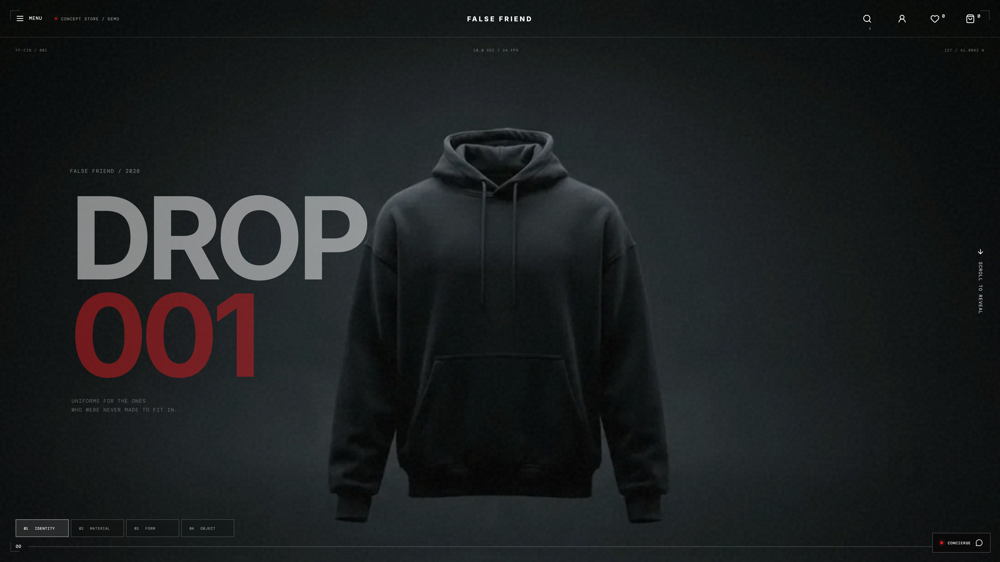

> Bu bir **vitrin reposudur**: çalışan uygulamanın görüntülerini, videolarını ve teknik anlatımını sunar. Uygulama kaynak kodları, veritabanı, giriş bilgileri ve dağıtım paketleri burada paylaşılmaz. Ödeme ve iade işlemleri simülasyondur.

## Projenin amacı

False Friend; editoryal bir moda markası deneyiminin gerçek katalog, müşteri hesabı, sepet ve sipariş işlevleriyle nasıl birlikte tasarlanabileceğini göstermek için geliştirildi. Müşteri bu çalışma üzerinden tasarımımı ve teknik yaklaşımımı inceleyebilir. Mağaza, müşterinin markasına uyarlanabilir veya ihtiyacına göre ayrı bir özel web sitesi geliştirilebilir.

Bu repo **ana projeyi** tanıtır. Açılıştaki Gemini videosu ve yapay zekâ ile üretilmiş konsept ürün görselleri korunmuştur. Template Edition ayrı bir sunumdur; bu repoda yer almaz.

## Videolar: gerçek gezinme, 2× hız

| Masaüstü — yaklaşık 47 saniye | Mobil — yaklaşık 15 saniye |
| --- | --- |
| [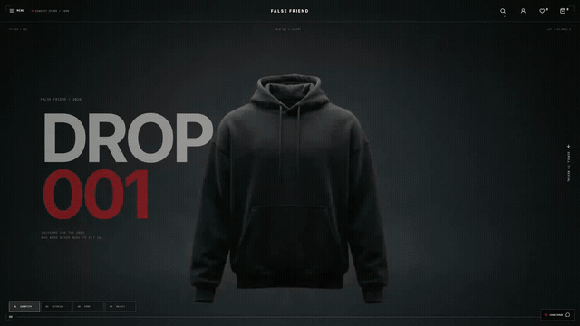](assets/videos/desktop-walkthrough-2x.mp4) | [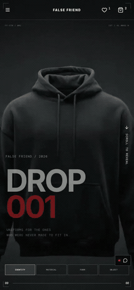](assets/videos/mobile-walkthrough-2x.mp4) |

Videolar dosyanın içinde iki kat hızlandırıldı; oynatıcıda ayrıca hız ayarı gerektirmez. Masaüstü MP4 1920×1080, mobil MP4 430×932 piksel ve 25 fps’tir. GIF’ler bu 2× videoların kısa önizlemeleridir; tam kaydı açmak için görsele tıklayın.

Masaüstü kayıt: açılış → ürün/galeri/varyant → sepet/kupon → kargo/ödeme incelemesi → koleksiyon/arama → lookbook/manifesto → hesap/favoriler. Mobil kayıt: açılış, menü, koleksiyon, ürün, sepet ve checkout.

Kayıtlar gerçek yerel uygulama ve backend üzerinden, hayalî müşteri/adres bilgileriyle alındı. Sahte API yanıtı kullanılmadı. Başlangıç yükleme beklemesi kısaltıldı; videolar durağan ekran görüntülerinden oluşturulmadı. Çekimde sipariş onayı verilmedi ve gerçek para hareketi yapılmadı. Ses/müzik eklenmedi.

## Tasarım ve etkileşim

- Kaydırmaya bağlı açılış videosu; Identity, Material, Form ve Object sahneleri.
- Sahne düğmeleri, ilerleme göstergesi ve öne çıkan ürüne geçiş.
- Katalogdan gelen ürün adı/fiyat/stok durumuyla güncellenen hero alanı.
- Büyük tipografi, koyu ürün sahnesi, editoryal koleksiyon ve malzeme/yapı incelemeleri.
- Kategori görseli, arama, favoriler ve para birimi kontrolleri içeren geniş navigasyon.
- Lookbook, manifesto, hizmet, gizlilik ve koşullar sayfalarında ortak görsel dil.
- Görsel yükleme yedeği ve video yüklenemezse mevcut kapak görseline geçiş.
- Ekran dışındayken video aramasını durdurma ve azaltılmış hareket tercihi desteği.

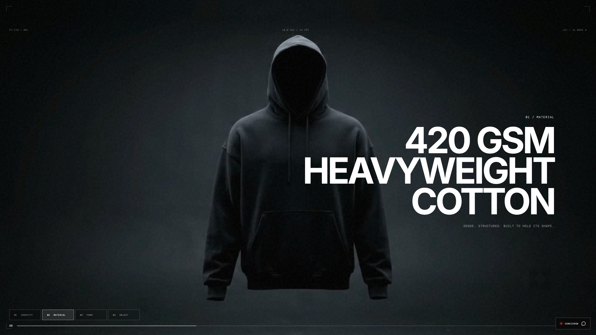

## Katalog ve ürünler

Demo kataloğu dört kategoride sekiz üründen oluşur: üst giyim, dış giyim, alt giyim ve aksesuar.

| Özellik | Davranış |
| --- | --- |
| Koleksiyon | Kategori filtresi, katalog araması, fiyat/isim sıralaması ve ızgara yoğunluğu |
| Ürün detayı | Açıklama, içerik, fit notları, fiyat, stok ve kategori bilgisi |
| Varyant | Beden/renk birleşimleri, varyant fiyatı ve stok sınırı |
| Galeri | Görsel geçişleri, küçük resimler, işaretçiyle inceleme ve tam ekran görünüm |
| Hızlı işlemler | Hızlı inceleme/ekleme ve favoriye alma |
| Ölçü rehberi | Mevcut bedenler ve kategoriye uygun genel fit rehberi |
| Canlı katalog | Frontend derlemesinden sonra eklenen ürünlerin API’den yüklenebilmesi |
| Ürün belgesi | Canlı katalogdan ilk HTML başlığı, sosyal görsel, canonical ve yapılandırılmış veri |
| Hata durumları | Olmayan ürün için gerçek 404; katalog bağlantı hatası için ayrı erişilemiyor durumu |

Gerçek fiziksel giysi ölçüleri bu konsept katalogda verilmez. Ürün malzemeleri, fiyatlar ve teslimat metinleri müşteri mağazasına uyarlanırken kesinleştirilir.

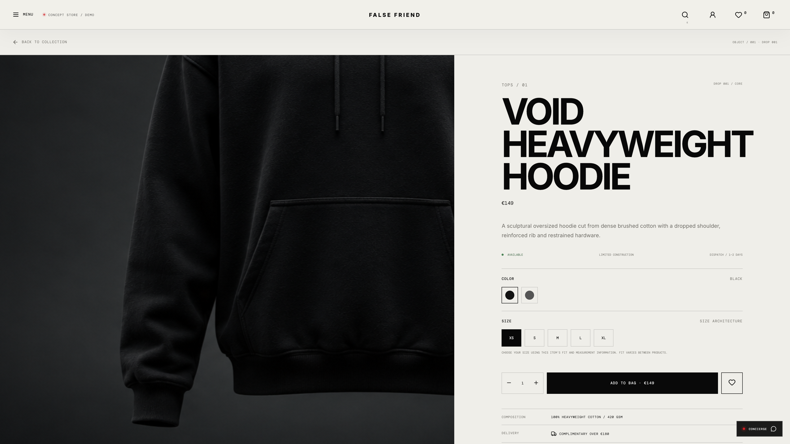
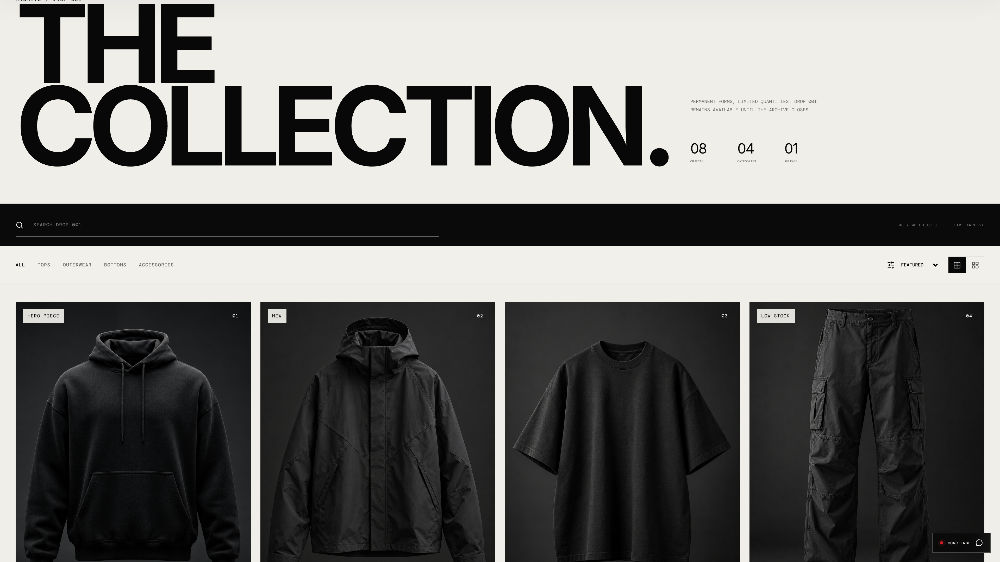

## Sepet, favoriler ve fiyatlandırma

Misafir sepeti ve favoriler tarayıcıda tutulur. Hesap açıldığında/giriş yapıldığında seçimler hesapla senkronize edilir. Miktar değiştirme, ürün kaldırma, kupon ve ücretsiz kargo eşiği geri bildirimi vardır.

Giriş yapmış müşterinin fiyatını sunucu hesaplar; stok ve varyant doğrulanır. Tarayıcıdan geri yüklenen seçimler canlı katalogla denetlenir. Yerel depodaki fiyat checkout fiyatı olarak kabul edilmez. Eski oturumun gecikmiş yanıtları yeni kullanıcının durumunu değiştiremez. Eksik kalan hesap senkronizasyonu açık bir yeniden deneme kontrolüyle toparlanabilir.

EUR, USD ve GBP görüntüleme desteklenir. USD/GBP sabit örnek kur üzerinden gösterilir; **checkout EUR üzerinden hesaplanır**.

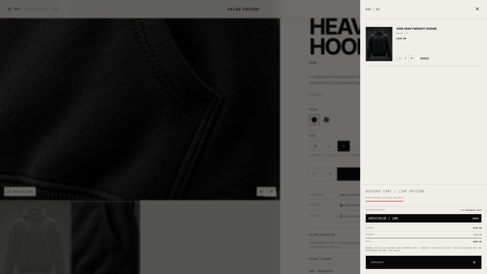

## Checkout ve sipariş kurtarma

Checkout; kayıtlı adres, kargo, ödeme önizlemesi ve son inceleme adımlarından oluşur.

1. API, ürün satırlarının anlık görüntüsünü, indirimi, kargoyu ve toplamı içeren fiyat teklifi üretir.
2. İncelenen teklif bir parmak iziyle sipariş isteğine bağlanır.
3. Teklif değişmişse kullanıcı yeniden fiyat alır ve açıkça tekrar onaylar.
4. Sipariş, güncel stok doğrulaması ve idempotency anahtarıyla tekrarlanan isteğe karşı korunur.
5. İstek öncesinde yalnızca müşteri/deneme kimliği içeren küçük bir yerel kurtarma kaydı tutulur.
6. Yanıt kaybolur veya sayfa yenilenirse önce salt okunur deneme sorgusu yapılır.
7. Önceki sonuç belirsiz/bekliyor durumundaysa yeni sipariş gönderimi bloke kalır.

Bu kurtarma aynı tarayıcı, origin ve müşteriyle sınırlıdır. Cihazlar arası kurtarma veya sekmeler arası atomik ödeme kilidi iddiası yoktur.

**Ödeme ve iade simülasyondur.** Gerçek kart tahsilatı yapılmaz. Vitrin videosu sipariş incelemesinde durur; simülasyon onayı/iadesi ayrı yerel kabul testleriyle kontrol edilmiştir.

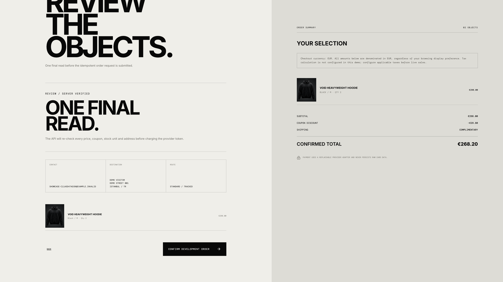

## Müşteri hesabı ve yönetim

| Alan | Uygulamadaki işlev |
| --- | --- |
| Hesap | Şifre tekrarıyla kayıt, giriş, çıkış ve oturum doğrulama |
| Profil/adres | Müşteri bilgileri, adres ekleme/düzenleme/silme ve varsayılan adres |
| Şifre değiştirme | Mevcut şifre denetimi, yeni şifre ve eski oturumun iptali |
| Sipariş | Geçmiş, detay ve korumalı takip |
| Yorum | Satın alma uygunluğu ve moderasyon |
| İade | Müşteri başvurusu, durum ve izin verilen aşamada iptal |
| Yönetim | Rol korumalı dashboard, sipariş listesi ve detayları |
| Operasyon | Geçerli durum geçişleri ve kargo/takip bilgileri |
| Moderasyon | Yorum onayı ve iade inceleme |
| Envanter | Gerekçeli varyant stok düzenleme |
| İz kaydı | Operasyon/audit olayları ve trace bağlamı |
| Arka plan işleri | Simülasyon iadesi ve süresi dolmuş checkout rezervasyonlarını toparlama |

Videoda müşteri tarafı gösterilir. Yönetim, tamamlanmış sipariş, moderasyon ve iade özellikleri özel uygulamanın kodu ve yerel kabul testlerine dayanılarak anlatılmıştır; videoda gösterilmiş gibi sunulmaz.

E-posta doğrulaması, bildirim gönderimi ve e-postayla unutulan şifreyi sıfırlama servisi bağlı değildir. Giriş yapmış kullanıcının şifre değiştirme akışı mevcuttur.

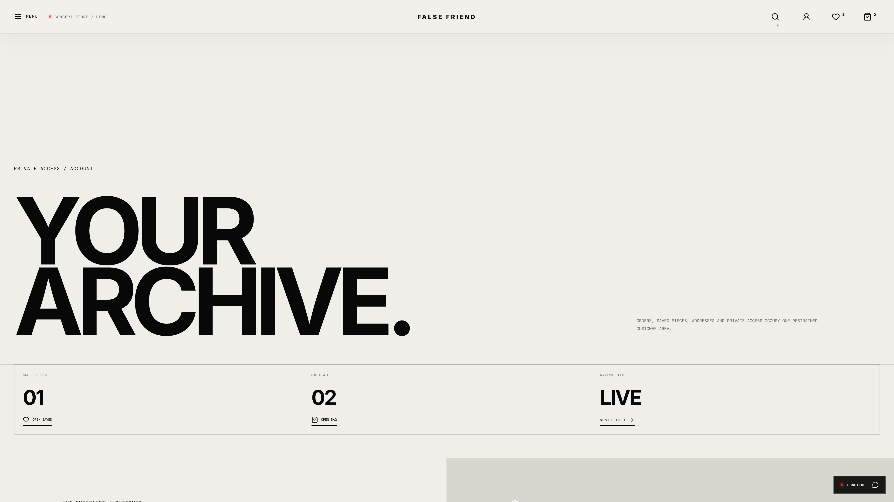

## İçerik, hizmet ve mobil deneyim

Lookbook editoryal ürün/malzeme karelerini ve etkileşimli reveal alanını içerir. Manifesto markanın konseptini anlatır. Hizmet alanı teslimat, iade, beden ve bakım yönlendirmesi sunar. Concierge bir site içi rehber panelidir; bülten formu e-posta göndermeyen, açıkça etiketlenmiş bir önizlemedir.

Telefon, tablet ve masaüstü düzenleri; mobil navigasyon, ürün bilgisi, sepet ve checkout ile uyarlanmıştır. Klavye odağı, modal odak sınırı, etiketler, Escape kontrolleri ve azaltılmış hareket desteği bulunur.

| Mobil açılış | Mobil ürün seçimi | Mobil checkout |
| --- | --- | --- |
| 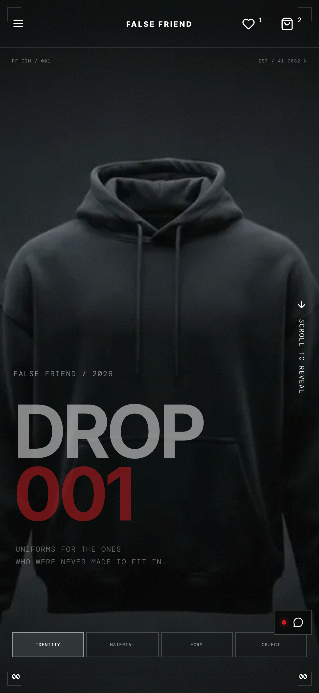 | 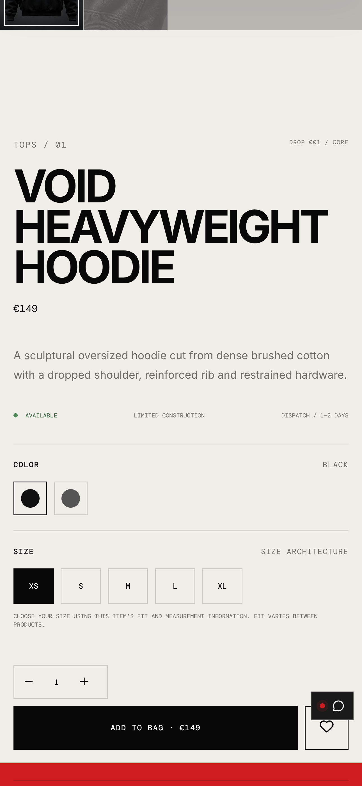 | 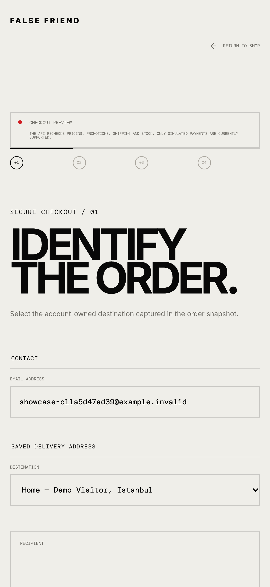 |

## Nasıl geliştirildi?

| Katman | Teknoloji / görev |
| --- | --- |
| Arayüz | React 19, TypeScript, React Router, Lucide |
| Tasarım | Özel responsive CSS, tipografi, geçiş ve kaydırmalı etkileşimler |
| Frontend araçları | Vite 7, TypeScript derlemesi, Node.js 24+ |
| API | ASP.NET Core 10 / C# |
| Uygulama katmanı | Katalog, hesap, sepet, teklif, sipariş, yorum, iade ve operasyon servisleri |
| Domain | Ürün, varyant, müşteri, adres, sipariş, yorum, iade ve audit modelleri |
| Veri | Entity Framework Core 10 ve PostgreSQL 17 |
| Arka plan | Süresi dolmuş checkout rezervasyonlarını toparlama |
| Dağıtım tasarımı | Docker Compose şablonları, Nginx proxy ve kalıcı data-protection anahtarları |
| Kontrol | .NET ve Node testleri, gerçek HTTP kabulü, Playwright/Chrome senaryoları |

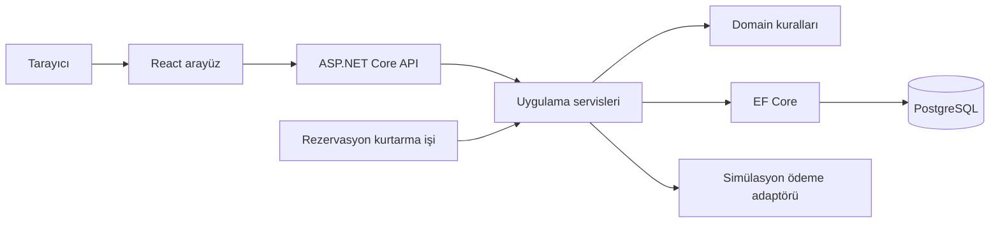

Arayüz etkileşimi yönetir; giriş yapmış kullanıcının fiyat/stok/sipariş kurallarını API belirler. İlk ürün HTML’inin meta bilgileri canlı katalogdan gelir; fiyat/stok bilgisi frontend derlemesinde dondurulmaz. Etkileşimli sayfayı React oluşturur.

Cookie tabanlı oturum, rol koruması, CSRF, kullanıcı sahipliği kontrolleri, şifre değişikliğinde oturum iptali, zaman aşımı/yeniden deneme kontrolleri, ayrı istek limitleri, gövde boyutu sınırı, açık CORS origin ayarı, güvenli cookie varsayımları ve güvenlik başlığı/CSP yapılandırması uygulanmıştır. Bunlar yerel kontrollerdir; yayın ortamı güvenlik denetimi ayrıca yapılır.

## Sayfa haritası

`/` açılış; `/shop` koleksiyon; `/product/:slug` ürün; `/lookbook` kampanya; `/about` manifesto; `/service` hizmet; `/account` hesap/adres/sipariş/iade; `/checkout` ödeme inceleme/kurtarma; `/admin` operasyon; `/privacy` ve `/terms` konsept politika sayfaları.

API; katalog, kimlik doğrulama, hesap, sepet, favori, checkout, sipariş, yorum, iade ve yönetim controller’larına ayrılmıştır. Bu yollar özel uygulamayı tarif eder; bu vitrin reposunda çalıştırılacak uygulama dosyaları değildir.

## Doğrulama özeti

Aşağıdaki sonuçlar ana projenin **20–21 Ekim 2026 tarihli yerel teslim-10 kontrollerine** aittir. Bu medya reposunda kaynak kodu için çalışan bir CI rozeti değildir.

| Kontrol | Sonuç |
| --- | --- |
| Backend | 55/55 |
| Node yardımcı/regresyon | 153/153 |
| Gerçek PostgreSQL + HTTP kabul | 27/27 |
| Mobil/masaüstü alışveriş | 32/32 |
| Responsive sayfa/ekran | 84/84 |
| Tarayıcı etkileşimi | 11/11 |
| Ürün/ekran | 24/24 |
| Erişilebilirlik semantik ön kontrolü | 36/36 |
| API çalışma zamanı güvenliği | 10/10 |
| Production varsayılanları | 15/15 |
| İlk HTML/sosyal görsel | 16/16 |
| Hesap hata durumları | 8/8 |
| Ağ/oturum/sipariş kurtarma | 19/19 |
| Medya/gerçek gezinme | 6/6 |
| Sentetik yedek/geri yükleme | Geçti |

Npm/NuGet taramaları yerel doğrulamada çalıştırıldı; sonuçlar o tarihe aittir. Özel loglar ve giriş bilgileri burada paylaşılmaz. Responsive testler 320–1440 CSS pikseli kapsar; vitrin çekimlerinde ayrıca 1920 px görünüm vardır.

### Sınırlar ve görülen bulgu

Gerçek ödeme/iade, e-posta ve bülten servisi bağlı değildir. USD/GBP sabit örnek kurdur. Fiziksel ürün ölçüleri verilmez. Gerçek işletme içerikleri, ödeme sağlayıcısı ve vergi/kargo kuralları müşteriye göre tamamlanır. Alan adı/HTTPS/hosting yayını bu vitrinin parçası olarak yapılmadı. Docker/Nginx çalışma zamanı, Safari/fiziksel cihaz ve kapsamlı WCAG denetimi doğrulanmış kabul edilmez.

1920 px çekimde site başlığı, tam ekran galerinin kapatma düğmesiyle çakışabildi. Galeri mevcut **Escape** kısayoluyla kapatıldı. Bulgu kayıtlıdır; bu medya yayını sorunun çözüldüğünü iddia etmez.

## Medya ve lisans

17 masaüstü PNG 3840×2160; yedi mobil PNG 1290×2796 piksel olarak gerçek arayüzden alındı. Yüksek piksel yoğunluğu ile çekim yapıldı. [Tüm kareler](docs/MEDIA.md) ve [medya manifesti](docs/MEDIA-MANIFEST.json) ayrı dosyalarda bulunur. Bu repoda yalnızca 2× videolar vardır; orijinal kayıtlar ve uygulama özel çalışma alanında korunur.

Repo içindeki dosyalar, mevcut vitrin repolarımla aynı **[Apache-2.0](LICENSE)** lisansı altında sunulur. Atıf/kapsam için [NOTICE](NOTICE) dosyasına bakın. Uygulama kaynakları, veritabanı ve dağıtım paketi burada yayınlanmaz; bu repo bir uygulama kurulum paketi değildir.

## Benimle çalışın

Bu deneyimi markanıza uyarlayabilir veya ihtiyacınıza özel bir web sitesi geliştirebilirim. Kapsam, entegrasyon, teslim ve destek proje bazında belirlenir.

**Kaan Tekin** · [GitHub](https://github.com/kaandevs-ops) · [kaantekin06@icloud.com](mailto:kaantekin06@icloud.com) · [WhatsApp](https://wa.me/905315698338)
